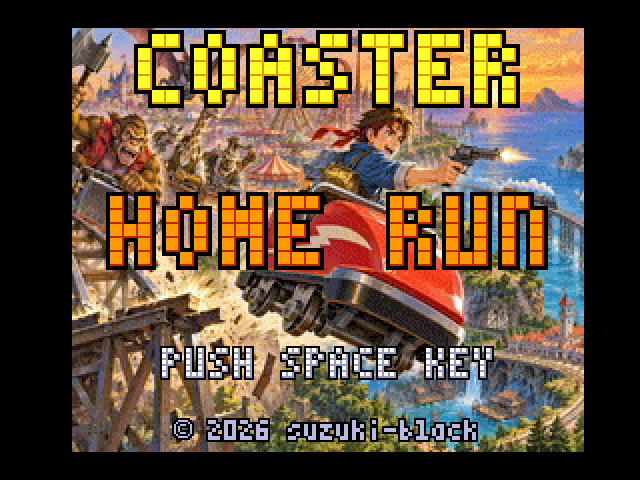
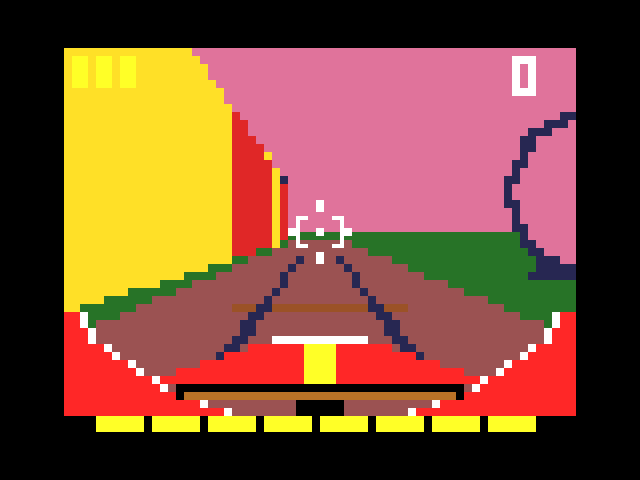
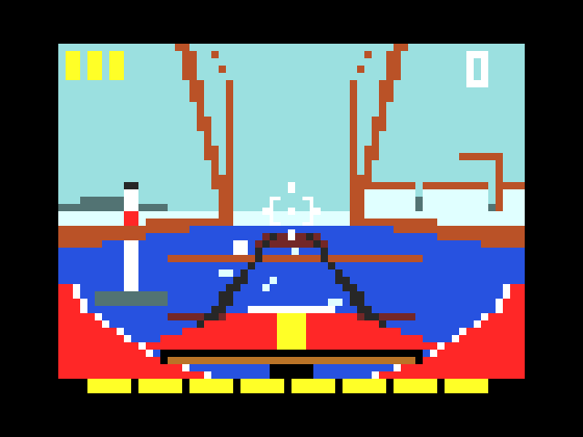
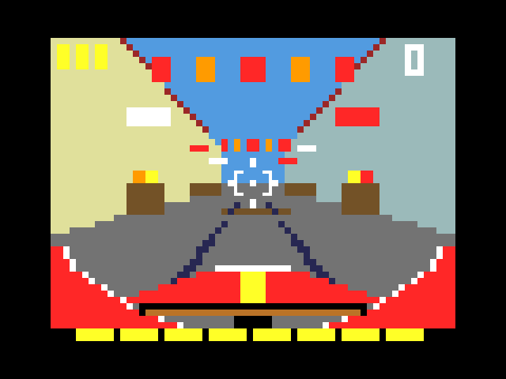
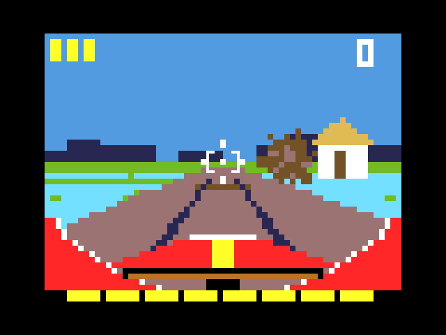

# COASTER HOME RUN

<p align="center">
  
</p>

> ⚠️ **This is a prototype** (work in progress), published for feedback and experimentation.
> **試作品（プロトタイプ・開発中）です。** フィードバックと実験のために公開しています。

A 3D rail shooter for the **MSX turboR** (R800 · V9958), drawn in **SCREEN 3** — the 64×48-block multicolour mode —
at 20–30 frames per second. Ride a runaway roller-coaster car through an amusement park, an underground lake, a forest,
a bridge over the sea, a festival town and home to your village, shooting the beast-men who chase you from the front
and from behind.

**Repository:** <https://github.com/suzuki-black/CoasterHomeRunR>

<p align="center">
  
  
  <br><sub>Stage 1 · along the park fence / ステージ1 遊園地の柵沿い　　Stage 4 · the sea bridge / ステージ4 海の鉄橋</sub>
</p>
<p align="center">
  
  
  <br><sub>Stage 5 · the festival street / ステージ5 祭りの町　　Stage 6 · paddies and the water wheel / ステージ6 田んぼと水車</sub>
</p>

**Download the ROM / ROM のダウンロード:** [Releases](https://github.com/suzuki-black/CoasterHomeRunR/releases/latest)

**Language:** [🇬🇧 English](#english) · [🇯🇵 日本語](#japanese)

---

<a name="english"></a>
## English

- [Story](#story)
- [Overview](#overview)
- [Features](#features)
- [Controls](#controls)
- [Requirements](#requirements)
- [Download](#download)
- [Building](#building)
- [Running](#running)
- [Testing](#testing)
- [Project structure](#project-structure)
- [Documentation](#documentation)
- [How it came to be](#how-it-came-to-be)
- [Scope & honest positioning](#scope--honest-positioning)
- [Feedback](#feedback)
- [Credits](#credits)
- [License](#license)
- [Disclaimer](#disclaimer)

### Story

> The village's treasure has been stolen. A young villager with a strong sense of justice learns that it is hidden in an
> amusement park run by beast-men — who are, in truth, a gang of thieves working there in disguise. He takes the treasure
> back from their hideout, but every exit is guarded. So he rides the roller coaster, jumps the gap in the track and flies
> over the park fence. The front car breaks loose and lands, alone, on rails that for some reason run outside the park:
> the gang laid a secret line all the way to the real railway, and in this world coaster rails and railway rails are the
> same gauge. The beast-men give chase. With the treasure tucked inside his coat, the young man rides the single car home.

### Overview
- **Platform:** MSX turboR software (4 Mbit (512 KB) ASCII8 MegaROM). The engine runs the R800 in DRAM mode.
- **Genre:** Single-player 3D rail shooter (gun-shooting style: move the sight, fire, turn to face front or back).
- **Structure:** 6 stages, each with a boss — the amusement park, the underground lake (crossed on a raft), the forest,
  the bridge over the sea, the festival town, and the village gate. With the mid-bosses of stages 1 and 2 there are
  eight bosses in all. Stages 1, 3 and 5 have a route branch. Durability (life) and score carry over between stages.
  Clearing the last stage leads to the ending.

### Features
- **3D in SCREEN 3.** Tunnels, lakes, forests, trusses and streets are drawn as polygons into a 64×48-block buffer and
  sent to the VDP; the transfer only sends what changed. Enemies are camera-facing block sprites with outlines, and the
  near ones get details (eyes, patterns, weapon glints).
- **The CPU changes with the size of the transfer (an experiment).** On the turboR every write to the VDP is held back:
  8.67 µs a byte for the R800, but 5.45 µs for the Z80. So the slower-clocked CPU is the faster one here. When 20 or more
  8-byte groups have changed, the game switches to the Z80 just for the transfer and then back; the round trip costs
  about 0.92 ms, so small updates stay on the R800. A full 1,536-byte transfer works out at about 9.3 ms instead of
  13.3 ms, and measured on an FS-A1ST a typical frame is 0.4–1.2 ms shorter than sending everything with the R800. It stays
  on the R800 while a voice is playing, and the hidden settings menu (`XFER`) can fix it to the R800 for comparison.
- **Scenery that changes inside each stage.** Each stage loads its own terrain module, so every stage has its own set
  pieces:

  | Stage | Set pieces |
  |---|---|
  | 1 The Escape | the coaster jump-off, the park fence with tents and a Ferris wheel, a coaster loop, a row of stalls, a castle with fireworks, a Y-shaped route branch |
  | 2 The Lake | a waterfall, a cave of glowing crystals, a sunken trolley, a natural rock arch |
  | 3 The Forest | a sunny glade, a log bridge over a stream, a tunnel through a hollow log, a Y-shaped route branch, a mossy shrine and a torii gate |
  | 4 The Bridge | a truss bridge high above the sea, waves and boats far below, a lighthouse, an arch span, the harbour ahead |
  | 5 The Town | a festival street with stalls and lanterns, a canal bridge, a fountain plaza where the route branches, the town gate |
  | 6 The Village | fences and thatched farmhouses, rice paddies with a scarecrow, a turning water wheel, the King's entrance, the village gate |
- **Front and back.** Attacks come from ahead and from behind; a warning (`ENEMY BEHIND!` / `ENEMY AHEAD!`) blinks and a
  voice calls it out. Press B to turn around.
- **Homing missiles.** Hold A and sweep the sight over enemies to lock up to four (beep-beep), then press B to fire one
  at a time. You start each stage with 3 and can carry 5.
- **Route branches.** In stages 1, 3 and 5 the track splits; shoot the beast-man holding the L or R sign to choose the
  side (left has more first-aid kits, right is all enemies). Shoot neither and the car goes right.
- **Battle laps.** Each stage has two or three stretches of track that circle back on themselves. While any enemy is left
  the car goes round again, and the next wave comes when the last one falls. Clear them all and `AREA CLEAR!` appears and
  the car speeds away.
- **The last boss has the floor.** Heavy, slow music builds, the King appears, the music stops and he speaks his line. You
  cannot fire until he has finished — attacking during a kabuki-style pose would be bad form — and then the battle theme
  starts.
- **Easy progression in stages 1 and 2.** While enemies remain on one side, none come from the other. From stage 3 on they
  come from both sides at once.
- **Reading the screen.** Enemies and enemy shots have a white outline, first-aid kits a yellow one. Points appear in white
  where the enemy was; durability changes appear above the car as a yellow "+2" or a red "-1".
- **Hit feel.** Hit-stop, enemies blown up and away, debris, screen shake when you are hit, and a chain of explosions
  synchronised with the sound when a boss falls.
- **Sound.** Every stage, the opening, the stage-clear jingle, the ending and the title have their own music on
  MSX-MUSIC (YM2413) with original instrument voices, doubled on the PSG with a slight detune; the last boss has two
  pieces of its own, one for the entrance and one for the battle. The drums are layered with PSG noise. Sound effects are
  on the PSG.
- **turboR internal PCM.** English voices — "Fire!", "Enemy ahead!", "Enemy behind!", "Warning!" and the last boss's
  "You will go no further!" — played during the game.
- **Title screen in natural-image mode.** The title illustration is shown in SCREEN 11 (YJK + YAE), with the logo and
  text in palette colours so they do not bleed.

### Controls
| Input | Keyboard | Joystick (port 1) |
|-------|----------|-------------------|
| Aim | Arrow keys | Direction |
| Fire / confirm | Space | Button A |
| Turn front / back | M or B | Button B |
| Fire a homing missile | Hold Space, press M or B | Hold A, press B |
| Hidden settings menu | On the title screen: ↑↑↓↓←→←→ B A (B and A are the B and A keys) — damage per hit, no damage, starting stage, starting durability, one-shot kills, route, easy progression, fps display, transfer method | |

### Requirements
- **MSX turboR only** (FS-A1ST / FS-A1GT). The cartridge checks for the turboR at boot and stops with
  `MSX turbo R required.` on anything older.
- The turboR system ROM is copyrighted and is **not** included.
- **The official WebMSX does not emulate the turboR PCM**, so the voices are silent there; the music and sound effects
  still play. Use openMSX or a real turboR to hear the voices.
- **Checked on real hardware:** the game has been played from the title through all 6 stages to the ending on a real
  FS-A1ST, with the ROM loaded from an ESERAMair (a Wi-Fi RAM cartridge), including the voices, the last boss's entrance
  and both routes of the stage 3 and stage 5 branches. Development and automated tests use openMSX. The FS-A1GT has not
  been tried on real hardware.

### Download
The ROM is on the [Releases page](https://github.com/suzuki-black/CoasterHomeRunR/releases/latest). The zip holds
`CoasterHomeRun [ASCII8].rom`; the `[ASCII8]` in the file name tells WebMSX the mapper type, so keep it when using
WebMSX. To run it on a real turboR you need a way to load an ASCII8 MegaROM image, such as a RAM cartridge.

### Building
Requires [SDCC](https://sdcc.sourceforge.net/) 4.6 (`sdcc` / `sdasz80`; C is compiled for the R800 with `-mr800`) and
Python 3 with Pillow.

```bash
make
```

This produces `build/TrolleyHomeRun.rom` (a 4 Mbit (512 KB) ASCII8 MegaROM) and a copy named
`build/TrolleyHomeRun [ASCII8].rom` for WebMSX. A full build takes about 8 minutes, because the register allocator is
set to search hard (`--max-allocs-per-node 100000`).

`make fpsrom` builds a measurement ROM that shows the frame rate and, on the title, the CPU state
(`CPU:R800 DRAM` / `R800 ROM` / `Z80`).

### Running
Under openMSX, with a turboR machine (e.g. `Panasonic_FS-A1ST`, which needs its system ROMs):

```bash
openmsx -machine Panasonic_FS-A1ST -carta build/TrolleyHomeRun.rom -romtype ASCII8
```

For development there is also `TH_turboR_dev`, a machine that runs C-BIOS on turboR hardware with the RAM in slot 3-0
like the FS-A1ST. `make machine` copies it to `~/.openMSX/share/machines/` (once), and `make run` starts the game on it.

In [WebMSX](https://webmsx.org/), choose a turboR machine and load `build/TrolleyHomeRun [ASCII8].rom` (the `[ASCII8]`
in the file name tells WebMSX the mapper type).

### Testing
The tests drive openMSX headless (`-script`) and judge the result. Results and screenshots go to `RUNDIR`.

```bash
make test RUNDIR=/path/to/scratch
```

Runs for about a minute and checks title → game → game over → title. `MACHINE=` switches the machine
(e.g. `MACHINE=Panasonic_FS-A1ST`).

```bash
make flow RUNDIR=/path/to/scratch GOD=1 TIMEOUT=2400
```

Plays the whole game automatically (aims at the nearest enemy, fires, turns when warned) and checks the opening, all
eight bosses, the ending and the return to the title. `GOD=1` keeps the durability from dropping. It takes about
27 minutes of emulated time.

Measurement tools: `make perf`, `make pcprof` (PC-sampling profile), `make overdraw STAGE=3`, and `make shotrom`
(a ROM without enemies, for checking the scenery).

### Project structure
```
src/boot/boot.s       ROM bank 0: boot, slot detection, turboR check, loader
src/engine/           engine: resident part (RAM 0x4000-0x7FFF), page-0 tables, and modules loaded into page 2
  crt0.s sys.s        entry, interrupt handler, input, PSG, mapper, ROM loader, module trampolines
  vdp.s raster.s      SCREEN 3 transfer; polygon fill with a shared edge cache (the hot path)
  geom.s gfx.s math.s projection, enemy-sprite drawing, buffer fills, fixed-point maths (MULUW)
  render.c rail.c     camera and near clipping; the rail table
  env.c truss.s       terrain (one module per stage)
  game.c models.c     player, enemies, hit tests, stage script, enemy models (one game module per stage)
  scene.c             ending, game over, hidden settings, SCREEN 3 set-up (scene module)
  main.c menu.c       start-up, title screen (SCREEN 11), stage flow
  fx.c hud.c trolley.c  effects (pop-ups, debris, boss explosions), HUD, the coaster car
  sound.c sndtick.c sndfm.s  sound-effect requests (resident); PSG and FM driver (sound module)
  pcm.s               turboR PCM voices
src/stage/            stage data (one per stage: rail, terrain zones, palette, script)
src/sound/songs.mml   music (MML); voicemod.bin: the voice samples
data/title_art.webp   the title illustration
tools/                gen_data.py gen_music.py gen_title.py gen_voice.sh (generators), mkrom.py (ROM packer),
                      check_stages.py check_models.py (stage data checks run by the build),
                      ressyms.py, model_preview.py, test_game.tcl test_flow.tcl perf*.tcl (tests and measurement),
                      openmsx/ (the development machine)
docs/                 design and development notes
```

### Documentation
- **[Specification / 仕様書](docs/TrolleyHomeRun_Spec.md)** — the game design, stages, memory and ROM maps, TODO.
- **[Development log / 検証記録](docs/検証記録.md)** — every measurement and change, with the reasons.
- **[SDCC and the R800 / SDCCとR800の調査](docs/SDCCとR800の調査.md)** — building C for the R800.
- **Performance studies** — [処理の重さの整理](docs/処理の重さの整理.md) and the replies to reviews
  ([意見](docs/処理の重さ_意見への回答.md) · [レビュー](docs/処理の重さ_レビューへの回答.md) · [再反論](docs/処理の重さ_再反論への回答.md)).
- **Background rendering studies** — [背景描画方式の比較](docs/背景描画方式の比較.md),
  [Z80 転送と行差分](docs/背景描画方式_Z80転送と行差分の検討.md), [詰めたバッファの計測](docs/背景描画方式_詰めたバッファの計測.md),
  [再反論への回答](docs/背景描画方式_再反論への回答.md).

### How it came to be
1. **A mine-cart rail shooter.** It started as a trolley ride through a mine — hence the file names `TrolleyHomeRun`.
2. **From trolley to coaster.** To give the game its own identity, the ride became a roller-coaster car that jumps out of
   an amusement park and lands on railway tracks. That needed one rule of the world: coaster rails and railway rails are
   the same gauge.
3. **Making SCREEN 3 3D fast enough.** Running the R800 in DRAM mode, a fill routine that shares edges between faces,
   a packed frame buffer sent as differences (large updates are sent by the Z80), and compiling C for the R800 —
   each step measured, and recorded in the [development log](docs/検証記録.md).
4. **More than fits in 64 KB.** The code grew into overlays: one terrain module and one game module per stage, plus sound,
   voice and scene modules. The ROM grew from 128 KB to 512 KB.

### Scope & honest positioning
This is an **experimental / study project**.

- **The point is 3D in SCREEN 3 on the turboR.** The frame rate is 20–30 fps (on an FS-A1ST, about 21–25 fps on average
  per stage), and detail was chosen over speed where it mattered for the feel.
- **It is still a prototype.** Balance and pacing are tuned by play-testing, and some things are still to do (see the TODO
  in the [specification](docs/TrolleyHomeRun_Spec.md)).

### Feedback
This is an experimental prototype released for feedback. Please use GitHub Issues to report bugs or share impressions.
Pull requests are welcome for clearly-scoped fixes.

### Credits
- **Original concept / direction:** suzuki-black
- **Program / graphics:** Claude Code (Anthropic Claude)
- **Music & sound effects:** Claude Code (Anthropic Claude) — original compositions, each written with a piece of classical
  music in mind as a model for its mood
- **Voices:** synthesized with [Flite](http://www.festvox.org/flite/) (voices "cmu_us_slt" and, for the last boss, "cmu_us_rms"), Copyright (c) 1999-2007 Language Technologies Institute, Carnegie Mellon University
- **Title illustration:** Microsoft Copilot × Claude Code (Anthropic Claude) — a collaboration

### License
**MIT** © 2026 suzuki-black. See [LICENSE](LICENSE).

### Disclaimer
This game is fiction. The beast-men, the places and the events are imaginary.

---

<a name="japanese"></a>
## 日本語

- [あらすじ](#あらすじ)
- [概要](#概要)
- [特徴](#特徴)
- [操作](#操作)
- [動作環境](#動作環境)
- [ダウンロード](#ダウンロード)
- [ビルド](#ビルド)
- [実行](#実行)
- [テスト](#テスト)
- [ディレクトリ構成](#ディレクトリ構成)
- [ドキュメント](#ドキュメント)
- [作られた経緯](#作られた経緯)
- [位置づけ](#位置づけ正直な自己評価)
- [フィードバック](#フィードバック)
- [クレジット](#クレジット)
- [ライセンス](#ライセンス)
- [免責](#免責)

### あらすじ

> 村の宝が盗まれた。正義感の強い村の若者は、獣人たちが働く遊園地に宝が隠されていることを突き止める。遊園地の獣人の
> 正体は、従業員を装った窃盗団だった。若者は隠れ家から宝を取り返すが、出入り口は屈強な獣人に囲まれている。そこで若者は
> ジェットコースターに乗り、レールの切れ目からジャンプして柵の外へ飛び出す。先頭の車両だけが切り離され、柵の外になぜか
> 敷かれていたレールに着地した――窃盗団が盗品を運ぶため、本物の鉄道の線路まで秘密のレールを敷いていたのだ。この世界では、
> ジェットコースターのレールと鉄道のレールは同じ規格。獣人たちが追ってくる。宝を懐にしまった若者は、一人乗りの車両で村へ帰る。

### 概要
- **対応機種:** MSX turbo R 用ソフト（4メガビット（512KB）の ASCII8 メガROM）。R800 の DRAM モードで動きます。
- **ジャンル:** 1人用・3D レールシューター（ガンシューティング型。照準を動かして撃ち、前後を振り向く）。
- **構成:** 全6面で、どの面にもボスがいます。遊園地 → 地底湖（筏で渡る）→ 森 → 海の鉄橋 → 祭りの町 → 村の入り口。
  1・2 面の中ボスを合わせてボスは全部で 8 体です。1・3・5 面にはルート分岐があります。耐久（ライフ）とスコアは面をまたいで
  持ち越し、最後の面をクリアするとエンディングです。

### 特徴
- **SCREEN 3 の 3D。** 坑道・湖・森・トラス・町並みを多角形で 64×48 ブロックのバッファに描き、VDP へは変わった所だけを
  送ります。敵はカメラに正対したブロックの絵（白い縁取り）で、近い敵には目・模様・武器の光などの細部が付きます。
- **転送の量で CPU を切り替える（実験的な工夫）。** turbo R では VDP へ書き込むたびに待ちが入り、1 バイトあたり R800 は
  8.67µs、Z80 は 5.45µs かかります。つまり、ここでは Z80 のほうが速く送れます。そこで、変わった組（8 バイト）が 20 組以上
  あるときは転送の間だけ CPU を Z80 に切り替えて、すぐ戻します。切り替えの往復に約 0.92ms かかるので、少ないときは R800 の
  まま送ります。全部の 1,536 バイトを送る場合は、計算では約 13.3ms が約 9.3ms に減ります。FS-A1ST の実測では、R800 だけで
  送るより 1 フレームあたり 0.4〜1.2ms 短くなりました。声を鳴らしている間は切り替えません。隠しコンフィグの `XFER` で
  R800 に固定して比べられます。
- **面の中で景色が変わる。** 面ごとに地形のモジュールを読み込み、どの面にも見せ場があります。

  | ステージ | 見せ場 |
  |---|---|
  | 1 遊園地 | コースターからの飛び出し、テントと観覧車の見える柵沿い、宙返りのコースター、屋台の並ぶ道、花火の上がるお城、Y 字に分かれる線路 |
  | 2 地底湖 | 滝、光る結晶の洞、沈んだトロッコ、岩の門 |
  | 3 森 | 木漏れ日の空き地、小川の丸太橋、倒木のトンネル、Y 字に分かれる線路、苔むした祠と鳥居 |
  | 4 海の鉄橋 | 海の上の高いトラス橋、ずっと下の白波と小舟、沖の灯台、アーチ橋、向こう岸の港 |
  | 5 町 | 屋台と提灯の祭りの通り、運河の橋、線路が分かれる噴水の広場、町の門 |
  | 6 村 | 柵と茅葺きの農家、かかしの立つ田んぼ、回る水車、亜人の王の登場、村の門 |
- **前と後ろ。** 敵は前からも後ろからも来ます。警告（`ENEMY BEHIND!` / `ENEMY AHEAD!`）が点滅し、声でも知らせます。
  B で振り向きます。
- **誘導弾。** A を押したまま照準で敵をなぞると最大 4 体までロックし（「ピピ」）、B で 1 発ずつ撃ちます。各面の始めに 3 発、
  最大 5 発まで持てます。
- **ルート分岐。** ステージ 1・3・5 では線路が分かれ、L か R の札を持った獣人を撃った側へ進みます（左は救急箱が多く、右は
  敵ばかり）。どちらも撃たなければ右へ進みます。
- **周回する戦闘区間。** どの面にも、線路が輪になった区間が 2〜3 か所あります。敵が残っている間は同じ輪をもう一周し、
  倒しきると次の波が来ます。一掃すると `AREA CLEAR!` が出て、速度を上げて抜けます。
- **最後のボスの登場。** 重くゆっくりした曲が高まり、亜人の王が現れると曲が止まり、静かな中で台詞を言います。歌舞伎の見得の
  ようなものなので、言い終えるまでは攻撃できません。言い終えると戦いの曲が始まります。
- **やさしい進行（ステージ 1・2）。** 片側の敵が残っている間は、反対側から敵が来ません。3 面からは前後から容赦なく来ます。
- **見分けのルール。** 敵と敵弾は白の縁取り、救急箱は黄の縁取り。得点は白い数字が敵の位置に、耐久の増減は黄の「+2」・赤の「-1」が
  車両の上に出ます。
- **手応え。** ヒットストップ、吹き飛ぶ敵、破片、被弾の画面の揺れ。ボスを倒すと効果音に合わせて爆発が続きます。
- **音楽と効果音。** 各面・オープニング・クリア・エンディング・タイトルの曲を MSX-MUSIC（YM2413）のオリジナル音色で鳴らし、
  PSG でわずかにずらして重ね、ドラムには PSG のノイズを重ねます。最後のボスには、登場と戦いの 2 曲を別に用意しました。
  効果音は PSG です。
- **turbo R 内蔵 PCM。** 英語の声（「Fire!」「Enemy ahead!」「Enemy behind!」「Warning!」、最後のボスの「You will go no
  further!」）をゲーム中に鳴らします。
- **自然画のタイトル画面。** タイトルの絵を SCREEN 11（YJK + YAE）で出し、ロゴと文字はパレットの色で重ねてにじませません。

### 操作
| 操作 | キーボード | ジョイスティック（ポート1） |
|------|-----------|-----------------------------|
| 照準 | カーソルキー | 方向 |
| 射撃・決定 | スペース | A ボタン |
| 前後の切り替え | M または B | B ボタン |
| 誘導弾を撃つ | スペースを押したまま M または B | A を押したまま B |
| 隠しコンフィグ | タイトルで ↑↑↓↓←→←→ B A（B・A はキーボードの B キー・A キー）。被弾で減る耐久・無敵・開始ステージ・始めの耐久・1 発で倒せる・分岐の固定・やさしい進行・fps 表示・転送のしかた | |

### 動作環境
- **MSX turbo R 専用**（FS-A1ST / FS-A1GT）。起動時に turbo R かを確かめ、それより前の機種では
  `MSX turbo R required.` と出して止まります。
- turbo R の本体 ROM は著作物のため**同梱していません**。
- **本家の WebMSX は turbo R の PCM を鳴らしません。** 声は無音になります（曲と効果音は鳴ります）。声を聞くには openMSX か
  実機を使ってください。
- **実機で動作を確認しています。** 実機の FS-A1ST に ESERAMair（Wi-Fi 付きの RAM カートリッジ）から ROM を載せ、タイトルから
  全 6 面を通してエンディングまで遊びました。声、最後のボスの登場、3 面と 5 面の分岐の左右も確かめています。開発と自動テストは
  openMSX で行っています。FS-A1GT の実機では試していません。

### ダウンロード
ROM は [Releases のページ](https://github.com/suzuki-black/CoasterHomeRunR/releases/latest)にあります。zip の中身は
`CoasterHomeRun [ASCII8].rom` です。ファイル名の `[ASCII8]` で WebMSX にマッパーの種類を伝えるので、WebMSX で使うときは
名前を変えないでください。実機の turbo R で動かすには、RAM カートリッジなど、ASCII8 のメガROM イメージを読み込める手段が必要です。

### ビルド
[SDCC](https://sdcc.sourceforge.net/) 4.6（`sdcc` / `sdasz80`。C は R800 向けに `-mr800` でコンパイル）と、Python 3（Pillow）が必要です。

```bash
make
```

`build/TrolleyHomeRun.rom`（4メガビット（512KB）の ASCII8 メガROM）と、WebMSX 用の名前のコピー `build/TrolleyHomeRun [ASCII8].rom`
ができます。レジスタの割り当てを念入りにしているので（`--max-allocs-per-node 100000`）、全体のビルドには約 8 分かかります。

`make fpsrom` で計測用 ROM を作ります。ゲーム中に fps を、タイトルに CPU の状態（`CPU:R800 DRAM` / `R800 ROM` / `Z80`）を出します。

### 実行
openMSX では turbo R の機種（例: `Panasonic_FS-A1ST`。本体 ROM が必要）で:

```bash
openmsx -machine Panasonic_FS-A1ST -carta build/TrolleyHomeRun.rom -romtype ASCII8
```

開発用には、C-BIOS を turbo R のハードで動かす機種 `TH_turboR_dev` もあります（RAM は FS-A1ST と同じスロット 3-0）。
`make machine` で `~/.openMSX/share/machines/` へコピーし（初回のみ）、`make run` でその機種で起動します。

[WebMSX](https://webmsx.org/) では turbo R の機種を選び、`build/TrolleyHomeRun [ASCII8].rom` を読み込みます
（ファイル名の `[ASCII8]` で WebMSX にマッパーの種類を伝えます）。

### テスト
openMSX をヘッドレス（`-script`）で動かして判定します。結果と画面は `RUNDIR` に出ます。

```bash
make test RUNDIR=/path/to/scratch
```

約 1 分走らせ、タイトル → ゲーム → ゲームオーバー → タイトルを判定します。`MACHINE=` で機種を切り替えられます
（例: `MACHINE=Panasonic_FS-A1ST`）。

```bash
make flow RUNDIR=/path/to/scratch GOD=1 TIMEOUT=2400
```

自動で遊び（一番手前の敵を狙って撃ち、警告と逆を向いていたら振り向く）、オープニング・8 体のボス・エンディング・タイトルへ
戻るまでを判定します。`GOD=1` で耐久を減らしません。エミュレータの時間で約 27 分かかります。

計測用: `make perf`、`make pcprof`（PC のサンプリングによるプロファイル）、`make overdraw STAGE=3`、
`make shotrom`（景色を確かめるための、敵を出さない ROM）。

### ディレクトリ構成
```
src/boot/boot.s       ROM bank0: 起動・スロット検出・turbo R の確認・ローダー
src/engine/           エンジン。常駐部(RAM 0x4000-0x7FFF)、ページ0の表、ページ2へ読み込むモジュール
  crt0.s sys.s        入口・割り込み・入力・PSG・マッパー・ROM の読み込み・モジュールの中継
  vdp.s raster.s      SCREEN 3 の転送、辺を面どうしで共有する多角形の塗り(ホットパス)
  geom.s gfx.s math.s 投影・敵の絵の描画・バッファの塗り・固定小数点演算(MULUW)
  render.c rail.c     カメラ・ニアクリップ、レール表
  env.c truss.s       地形(ステージごとのモジュール)
  game.c models.c     プレイヤー・敵・当たり判定・台本・敵の絵(ステージごとのゲームモジュール)
  scene.c             エンディング・ゲームオーバー・隠しコンフィグ・SCREEN 3 の作り直し(場面のモジュール)
  main.c menu.c       起動・タイトル画面(SCREEN 11)・ステージの流れ
  fx.c hud.c trolley.c  演出(数字・破片・ボスの爆発)、HUD、コースターの車両
  sound.c sndtick.c sndfm.s  効果音の予約(常駐部)、PSG と FM のドライバ(音のモジュール)
  pcm.s               turbo R の PCM の声
src/stage/            ステージのデータ(レール・地形の区間・パレット・台本)
src/sound/songs.mml   曲(MML)。voicemod.bin は声のデータ
data/title_art.webp   タイトルの絵
tools/                gen_data.py gen_music.py gen_title.py gen_voice.sh(生成)、mkrom.py(ROM の組み立て)、
                      check_stages.py check_models.py(ビルドのときに走るステージのデータの検査)、
                      ressyms.py、model_preview.py、test_game.tcl test_flow.tcl perf*.tcl(テストと計測)、
                      openmsx/(開発用の機種)
docs/                 設計・開発ノート
```

### ドキュメント
- **[仕様書](docs/TrolleyHomeRun_Spec.md)** — ゲームの設計、全ステージ、メモリと ROM の配置、TODO。
- **[検証記録](docs/検証記録.md)** — 計測と変更のすべてと、その理由。
- **[SDCCとR800の調査](docs/SDCCとR800の調査.md)** — C を R800 向けにビルドする調査。
- **処理の重さの検討** — [処理の重さの整理](docs/処理の重さの整理.md) と、いただいた意見への回答
  （[意見](docs/処理の重さ_意見への回答.md)・[レビュー](docs/処理の重さ_レビューへの回答.md)・[再反論](docs/処理の重さ_再反論への回答.md)）。
- **背景の描き方の検討** — [背景描画方式の比較](docs/背景描画方式の比較.md)、[Z80 転送と行差分](docs/背景描画方式_Z80転送と行差分の検討.md)、
  [詰めたバッファの計測](docs/背景描画方式_詰めたバッファの計測.md)、[再反論への回答](docs/背景描画方式_再反論への回答.md)。

### 作られた経緯
1. **トロッコのレールシューター。** 最初は鉱山をトロッコで走るゲームでした。ファイル名の `TrolleyHomeRun` はその名残です。
2. **トロッコからコースターへ。** このゲームならではの形にするため、遊園地のジェットコースターから車両が飛び出して鉄道の
   線路に着地する筋にしました。そのために「ジェットコースターと鉄道のレールは同じ規格」という世界の決まりを置いています。
3. **SCREEN 3 の 3D を速くする。** R800 の DRAM モード、面どうしで辺を共有する塗り、詰めた描画バッファの差分の転送
   （量が多いときは Z80 で送る）、C の R800 向けのコンパイル。どれも測りながら進め、[検証記録](docs/検証記録.md)に
   残しています。
4. **64KB に収まらない。** コードはオーバーレイになりました。ステージごとの地形とゲームのモジュール、音・声・場面のモジュール。
   ROM は 128KB から 512KB に増えました。

### 位置づけ（正直な自己評価）
本作は**実験的な習作**です。

- **主題は turbo R の SCREEN 3 で 3D を動かすこと**です。フレームレートは 20〜30fps（FS-A1ST で、面ごとの平均は約 21〜25fps）で、
  手応えに効く所では速さより描き込みを選んでいます。
- **まだ試作品**です。難しさや間合いは遊びながら調整していて、まだやることも残っています（[仕様書](docs/TrolleyHomeRun_Spec.md)の TODO）。

### フィードバック
本作はフィードバックのために公開している実験的な試作品です。不具合報告や感想は GitHub Issues でお願いします。
範囲の明確な修正の Pull Request も歓迎します。

### クレジット
- **原案・ディレクション:** suzuki-black
- **プログラム／グラフィック:** Claude Code（Anthropic Claude）
- **音楽・効果音:** Claude Code（Anthropic Claude）― オリジナル。曲ごとにクラシック曲を雰囲気の手本にして書いたもの
- **声:** [Flite](http://www.festvox.org/flite/)（声は cmu_us_slt。最後のボスは cmu_us_rms）で作成。Copyright (c) 1999-2007 Language Technologies Institute, Carnegie Mellon University
- **タイトルイラスト:** Microsoft Copilot × Claude Code（Anthropic Claude）の合作

### ライセンス
**MIT** © 2026 suzuki-black. 詳細は [LICENSE](LICENSE) を参照。

### 免責
本作はフィクションです。獣人・土地・出来事はすべて架空のものです。
